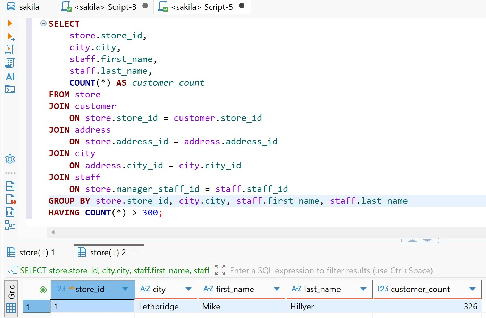
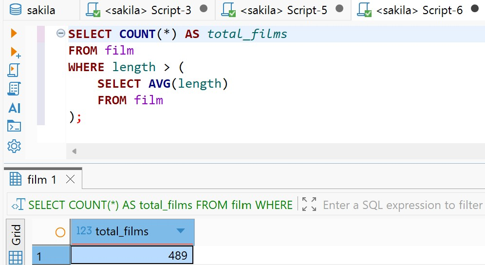
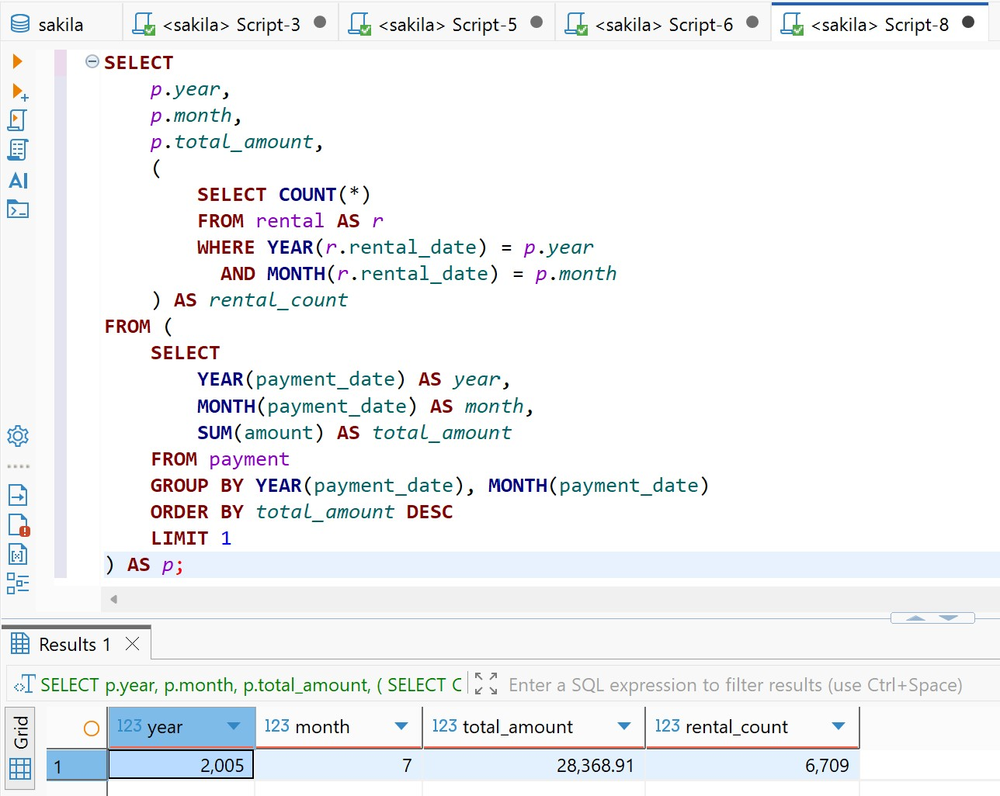
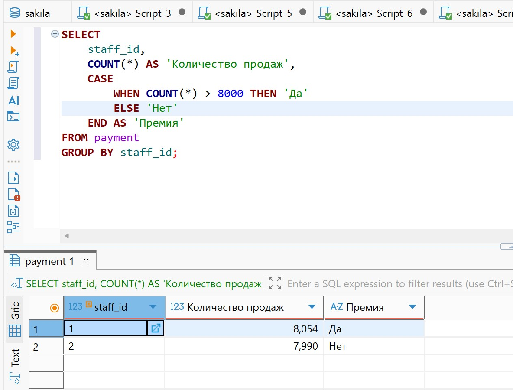
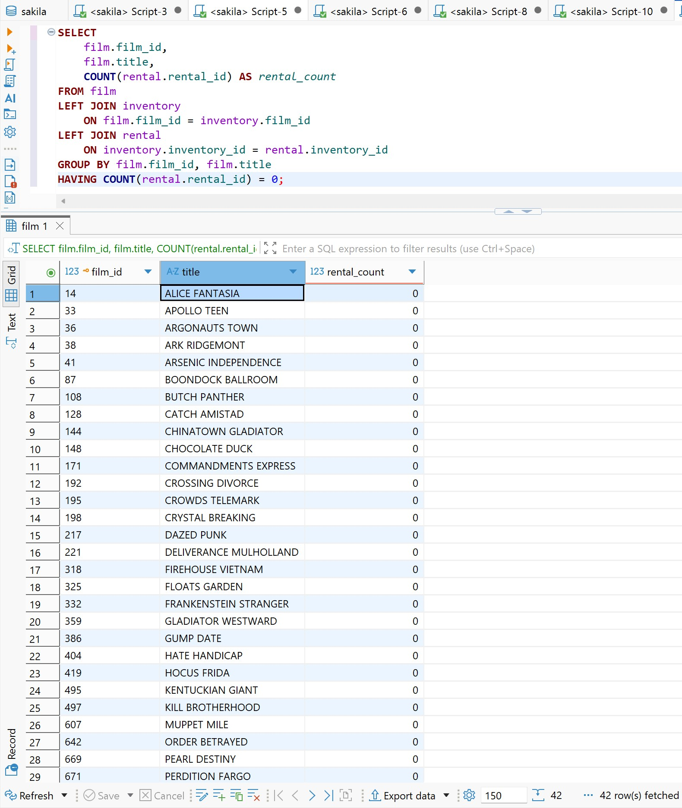

# Расширенный возможности MySQL
# Антон Сап

## Задание 1.

```sql
SELECT
    store.store_id,
    city.city,
    staff.first_name,
    staff.last_name,
    COUNT(*) AS customer_count
FROM store
JOIN customer ON store.store_id = customer.store_id
JOIN address ON store.address_id = address.address_id
JOIN city ON address.city_id = city.city_id
JOIN staff ON store.manager_staff_id = staff.staff_id
GROUP BY store.store_id, city.city, staff.first_name, staff.last_name
HAVING COUNT(*) > 300;
```

**Результат:** магазин №1, Lethbridge, Mike Hillyer — **326 покупателей**.



## Задание 2.

```sql
SELECT COUNT(*) AS total_films
FROM film
WHERE length > (
    SELECT AVG(length)
    FROM film
);
```

**Результат:** **489 фильмов**.



## Задание 3.

```sql
SELECT
    p.year,
    p.month,
    p.total_amount,
    (
        SELECT COUNT(*)
        FROM rental AS r
        WHERE YEAR(r.rental_date) = p.year
          AND MONTH(r.rental_date) = p.month
    ) AS rental_count
FROM (
    SELECT
        YEAR(payment_date) AS year,
        MONTH(payment_date) AS month,
        SUM(amount) AS total_amount
    FROM payment
    GROUP BY YEAR(payment_date), MONTH(payment_date)
    ORDER BY total_amount DESC
    LIMIT 1
) AS p;
```

**Результат:** июль 2005 года — **28 368,91** сумма платежей и **6 709 аренд**.



## Задание 4*. Продажи сотрудников и премия

```sql
SELECT
    staff_id,
    COUNT(*) AS 'Количество продаж',
    CASE
        WHEN COUNT(*) > 8000 THEN 'Да'
        ELSE 'Нет'
    END AS 'Премия'
FROM payment
GROUP BY staff_id;
```

**Результат:** сотрудник №1 — **8 054, Да**; сотрудник №2 — **7 990, Нет**.



## Задание 5*.

```sql
SELECT
    film.film_id,
    film.title,
    COUNT(rental.rental_id) AS rental_count
FROM film
LEFT JOIN inventory ON film.film_id = inventory.film_id
LEFT JOIN rental ON inventory.inventory_id = rental.inventory_id
GROUP BY film.film_id, film.title
HAVING COUNT(rental.rental_id) = 0;
```

**Результат:** **42 фильма** без аренд.


